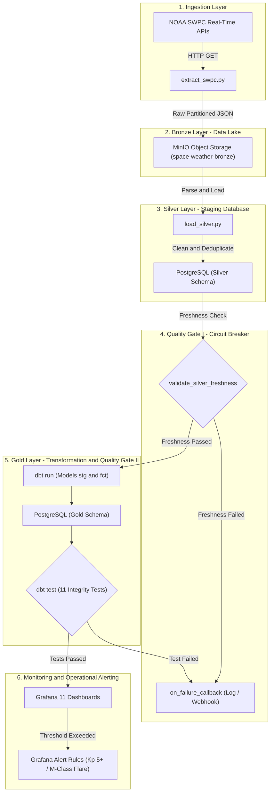

# NOAA Space Weather — End-to-End Real-Time Data Engineering Pipeline

[](https://python.org)
[](https://www.docker.com/)
[](https://airflow.apache.org/)
[](https://www.postgresql.org/)
[](https://min.io/)
[](https://www.getdbt.com/)
[](https://grafana.com/)

A production-grade, enterprise Data Engineering pipeline designed to ingest, clean, model, test, and monitor near real-time space weather data from the **NOAA Space Weather Prediction Center (SWPC)**. The project strictly implements the **Medallion Architecture (Bronze -> Silver -> Gold)** with defense-in-depth data quality gates, automated orchestration, and real-time operational observability.

---

## System Architecture



---

## Technology Stack

| Component | Technology | Version | Purpose & Description |
| :--- | :--- | :---: | :--- |
| **Object Storage** | **MinIO** | Latest | S3-compatible Data Lake holding immutable raw Bronze JSON files. |
| **Data Warehouse** | **PostgreSQL** | 16 | Relational store housing the cleaned `silver` staging and `gold` dimensional marts. |
| **Orchestrator** | **Apache Airflow** | 2.10 | Linear DAG scheduling, dependency management, retry policies, and alerts. |
| **Transformation** | **dbt-core** | 1.8 | Modular SQL/Jinja modeling, custom schema resolution, and automated testing. |
| **Monitoring** | **Grafana** | 11.2 | Real-time observability dashboard with log-scale time-series and alert rules. |
| **Containerization**| **Docker Compose** | v2 | Full infrastructure-as-code orchestration across all services. |

---

## Medallion Architecture Overview

### 1. Bronze Layer (Raw Storage)
- **Engine**: MinIO S3-compatible object storage (`space-weather-bronze`).
- **Partition Scheme**: `space-weather-bronze/<dataset_name>/year=YYYY/month=MM/day=DD/<dataset_name>_YYYYMMDD_HHMMSS.json`.
- **Properties**: Immutable, raw, append-only JSON files as emitted by NOAA SWPC.

### 2. Silver Layer (Cleaned Staging)
- **Engine**: PostgreSQL schema `silver`.
- **Tables**:
  - `silver.planetary_k_index`: 3-hour / 1-minute planetary Kp index and station counts.
  - `silver.solar_wind_mag`: Interplanetary Magnetic Field (IMF) vectors (Bx, By, Bz) and total field strength (Bt).
  - `silver.solar_wind_plasma`: Proton density (p/cm3), bulk speed (km/s), and ion temperature (K).
  - `silver.goes_xrays`: Primary & secondary solar X-ray wavelength fluxes (W/m2).
- **Features**: Idempotent upserts (`ON CONFLICT DO UPDATE`), timestamp validation with UTC timezone (`timestamptz`), rejection of null observation timestamps.

### 3. Gold Layer (Curated Data Marts)
- **Engine**: PostgreSQL schema `gold` managed via **dbt-core**.
- **Models**:
  - `gold.fct_geomagnetic_activity`: Planetary Kp index enriched with NOAA G-Scale storm classifications (`G0 - Normal` to `G5 - Extreme`) and IMF Bz coupling.
  - `gold.fct_solar_flare_activity`: GOES X-ray flux enriched with solar flare classifications (`A`, `B`, `C`, `M`, `X`) and base-10 magnitude.
  - `gold.fct_solar_wind_conditions`: Combined solar wind plasma and magnetic dynamics with high-speed stream detection flags (speed >= 500 km/s).

---

## Data Quality and Defense-in-Depth

The pipeline features a 4-layer defense system:

1. **Gate 1 — Freshness Circuit Breaker**:
   - An Airflow `@task` verifies that all 4 Silver tables received updates in the last 60 minutes (`loaded_at > now() - interval '60 minutes'`).
   - If any feed is stale or missing, an `AirflowFailException` is thrown, halting downstream dbt transformations instantly.
2. **Gate 2 — dbt Data Integrity Tests**:
   - 11 automated tests (`not_null`, `unique`, `relationships`, `accepted_values`) are executed on every run.
   - Any anomaly returns exit code `1` and fails the Airflow task.
3. **Gate 3 — Pipeline Failure Callback**:
   - Built-in `on_failure_callback: notify_failure` logs structured error diagnostics with execution context, exception details, and optional webhook dispatch.
4. **Gate 4 — Operational Space Weather Alerts**:
   - **Geomagnetic Storm Alert (Kp >= 5)**: Detects NOAA G1+ storms.
   - **Solar Flare Alert (Flux >= 1.0e-5 W/m2)**: Detects M-Class and X-Class solar flares that cause high-frequency radio blackouts.

---

## Project Directory Structure

```
SWPC/
├── .env.example                               # Environment configuration template
├── .gitignore                                 # Git ignore file
├── docker-compose.yml                         # Multi-container orchestration stack
├── Dockerfile.airflow                         # Extended Airflow image with dbt-postgres
├── requirements.txt                           # Python dependencies
├── panduan.md                                 # Full technical guide (Indonesian)
├── airflow/
│   ├── dags/
│   │   └── dag_space_weather_pipeline.py      # Master orchestration DAG with circuit breaker
│   ├── logs/                                  # Task runtime logs (gitignored)
│   └── plugins/                               # Custom Airflow plugins
├── dbt/
│   └── space_weather/
│       ├── dbt_project.yml                    # dbt project configuration
│       ├── packages.yml                       # dbt packages (dbt_utils)
│       ├── profiles.yml                       # PostgreSQL database connection profile
│       ├── macros/
│       │   └── generate_schema_name.sql       # Custom macro targeting 'gold' schema
│       └── models/
│           ├── staging/                       # Views over Silver layer (stg_*)
│           └── marts/                         # Production Fact Marts (fct_*)
├── grafana/
│   └── provisioning/
│       ├── datasources/
│       │   └── postgres.yml                   # Automated DWH datasource provisioning
│       ├── dashboards/
│       │   ├── dashboard-provider.yml         # Dashboard loader configuration
│       │   └── space_weather_overview.json    # 7-panel operational dashboard
│       └── alerting/
│           └── alert_rules.yml                # File-based alert rules (Kp >= 5 & M-Flare)
├── scripts/
│   ├── extract_swpc.py                        # Ingestion: NOAA SWPC APIs -> MinIO Bronze
│   └── load_silver.py                         # Loading: MinIO Bronze -> PostgreSQL Silver
└── sql/
    └── init/
        └── 01_init_schemas.sql                # DDL initialization for silver & gold schemas
```

---

## Quickstart and Setup

### 1. Prerequisites
- **Docker Desktop** installed and running on Windows (WSL2 backend enabled).
- **Git** and **Python 3.11+** installed locally.

### 2. Clone Repository and Setup Environment
```powershell
git clone <repository-url>
cd SWPC

# Copy environment variable template
cp .env.example .env
```

### 3. Launch Docker Services
```powershell
docker compose up -d --build
```

Verify that all containers are healthy:
```powershell
docker compose ps
```

| Service | Container Name | Port | Default Credentials |
| :--- | :--- | :---: | :--- |
| **PostgreSQL** | `sw_postgres` | `5432` | User: `dwh_admin` / Pass: `SpaceWeather_2026!` |
| **MinIO API** | `sw_minio` | `9000` | User: `minio_admin` / Pass: `MinioSecure_2026!` |
| **MinIO Console** | `sw_minio` | `9001` | Web UI Console |
| **Airflow Webserver** | `sw_airflow_webserver` | `8080` | User: `airflow_admin` / Pass: `AirflowSecure_2026!` |
| **Grafana** | `sw_grafana` | `3000` | User: `grafana_admin` / Pass: `GrafanaSecure_2026!` |

---

## End-to-End Pipeline Execution

Trigger the full pipeline manually from the CLI:

```powershell
docker exec -it sw_airflow_scheduler airflow dags trigger space_weather_pipeline
```

Monitor execution status:
```powershell
docker exec -it sw_airflow_scheduler airflow dags list-runs -d space_weather_pipeline
```

Verify final Gold layer data:
```powershell
docker exec -it sw_postgres psql -U dwh_admin -d space_weather_dwh -c "SELECT MAX(observed_at) AS data_terbaru, COUNT(*) AS total_baris FROM gold.fct_geomagnetic_activity;"
```

---

## Operational Monitoring (Grafana)

Open your browser at `http://localhost:3000` (User: `grafana_admin`, Pass: `GrafanaSecure_2026!`).

Navigate to **Dashboards -> Space Weather -> Space Weather Intelligence - Overview**:
1. **Current Kp Index Stat Card**: Immediate geomagnetic status with color-coded warning levels.
2. **Current Solar Wind Speed Card**: Speed in km/s with High Speed Stream alerts (speed >= 500 km/s).
3. **Latest GOES X-Ray Flux Card**: Flux intensity with solar flare classifications.
4. **Planetary Kp Trend Series**: Synchronized crosshair line chart with NOAA G1 to G5 storm threshold lines.
5. **GOES Solar X-Ray Flux (Log10 Scale)**: Logarithmic curve highlighting class A, B, C, M, and X flare events.
6. **Solar Wind & IMF Bz Dynamics**: Dual-axis graph correlating wind velocity with Southward magnetic field orientation.
7. **Geomagnetic Storm Distribution (Donut Chart)**: Proportion of observations per G-scale category within the selected time window.

---

## License and Attribution
- Data provided by the **National Oceanic and Atmospheric Administration (NOAA) / Space Weather Prediction Center (SWPC)**.
- Licensed under the **MIT License**.
